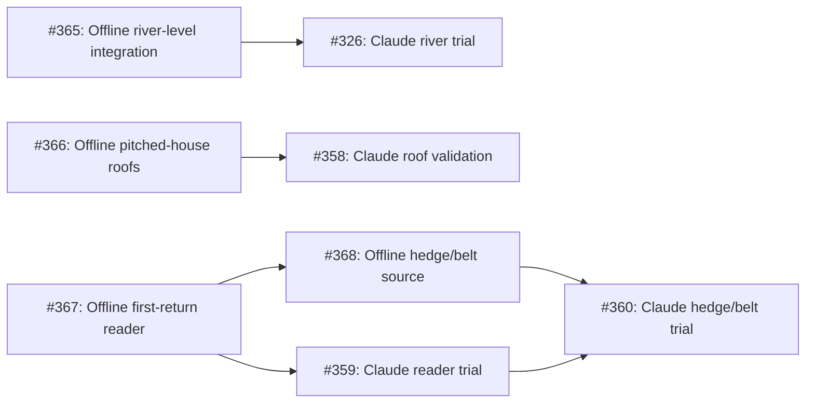

# Further Claude / offline task splits

Recorded 2026-11-21. These are scope and dependency changes, not task dispatches.
The existing task numbers keep the real-world trials; four new tickets hold
independently verifiable engineering work.

| Existing Claude task | New offline task | Boundary |
| --- | --- | --- |
| #326 river-level trial | #365 per-segment water-body spec and planner | Synthetic water/bed/bank/clipping plans versus real lidar, reach specs and in-game transitions. |
| #358 pitched house-roof validation | #366 shared-material and pitched-roof implementation | Synthetic roof geometry and legacy compatibility versus real-spec dry run and owner review. |
| #359 first-return reader trial | #367 reader/fallback/gate implementation | Fake height clients and circular-gate fixtures versus the normal rural-cell build. |
| #360 hedge/belt trial | #368 class-configured source integration | Synthetic hedge/lane/belt/shadow evidence versus real-evidence tuning and in-game verdict. |

## Acceptance boundaries

All four new tasks have `requiresClaude: false`. Their full scopes and acceptance
checks are in `tasks/index.json`. They use synthetic fixtures, fake providers and
source review only. Running ordinary unit tests of the builders is allowed.
They do not interpret place evidence, generate a real-place build spec, run a
representative build dry run/apply, download evidence or judge a result in game.
A successful engineering ticket unblocks its trial; it does not prove the real
build looks right or close a world snag.

The parent tasks remain `requiresClaude: true`. Claude model/access/budget checks
still apply when dispatching them. This split does not dispatch any task or
change the approved model/effort ceiling. Schema and substantial planner changes
remain stretches when their implementation is dispatched.

Use the existing water-body builder, roof-material module, tree reader/source
gate and class configuration. Do not add parallel builders or a placeholder
shared interface. #354's water-level profiling already landed; #365 integrates
it. #366 is the already-ticketed house-build integration that #356 should
recognize. #367 and #368 both touch the tree layer, so the source integration
waits for the reader implementation. Its offline work need not wait for #359's
in-game verdict; the final #360 trial still does.

## Tasks retained without another split

- #318 woodland already split its engineering into #347-#351 (now completed);
  #364 is an existing offline woodland-floor follow-up. Its remaining evidence
  tuning and proving builds belong with Claude.
- #256 railway and #257 typology are exploratory build trials. Their findings
  determine the useful reusable implementation; avoid pre-filing speculative
  production mechanisms. Existing location selections and rebuild permissions
  remain recorded in the world repo.
- #333 shop typology still waits for #257's findings before its implementation
  shape can be settled.
- #352 is the live river-join check; its offline equivalence checks already pass.
- #357's core deliverable is evidence-based roof-family recommendations and
  visual checks. Its small lookup/catalogue edit stays with that task, avoiding
  an empty type framework before the recommendations exist.
- #356, #361, #362 and #364 are already non-Claude tasks.

World evidence, sample values, selected places, generated specs and trial
artifacts stay in the active world's repo. This plan records tool work only.
